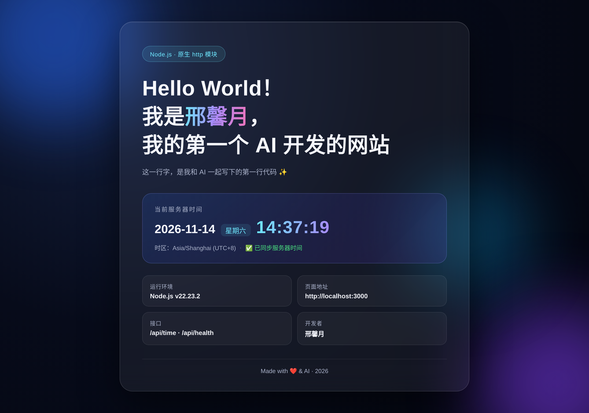

# Hello World 网站（Node.js 原生实现）

我的第一个 AI 开发的网站 —— 零依赖、开箱即跑。

## 预览



## 功能
- 浏览器访问首页显示「Hello World！我是邢馨月，我的第一个 AI 开发的网站」
- 实时显示**当前服务器时间**（页面每秒请求 `/api/time`，以服务端时间为准，不是浏览器时间）
- 附带健康检查接口 `/api/health`（返回运行状态、Node 版本、已运行秒数）
- 响应式布局，手机端同样正常显示

## 环境要求
- Node.js **v16 及以上**（本机验证版本：v22.23.2）
- 无需 `npm install`，项目不依赖任何第三方包

## 运行命令

```bash
# 1. 进入项目目录
cd nodejs-helloworld

# 2. 启动服务
node server.js
#   或者
npm start

# 3. 浏览器访问
#    http://localhost:3000
```

输出示例：

```
  ✅ 服务已启动
  🌐 本地访问： http://localhost:3000
  🕐 服务器时间： 2026-11-14 15:30:05（星期六）
  按 Ctrl + C 停止服务
```

## 换端口

```bash
PORT=8080 node server.js
```

## 目录结构

```
nodejs-helloworld/
├── package.json          # 项目描述与启动脚本
├── server.js             # 服务器主程序（路由 / 时间接口 / 静态文件）
├── README.md             # 说明文档
└── public/               # 前端静态资源
    ├── index.html        # 首页
    └── style.css         # 样式
```

## 接口说明

| 方法 | 路径 | 说明 |
| --- | --- | --- |
| GET | `/` | 首页 |
| GET | `/api/time` | 返回服务器时间 JSON |
| GET | `/api/health` | 返回运行状态 |
| GET | `/style.css` | 样式表（静态资源） |

`GET /api/time` 返回示例：

```json
{
  "datetime": "2026-11-14 15:30:05",
  "weekday": "星期六",
  "timezone": "Asia/Shanghai (UTC+8)",
  "timestamp": 1763105405000,
  "iso": "2026-11-14T07:30:05.000Z"
}
```
